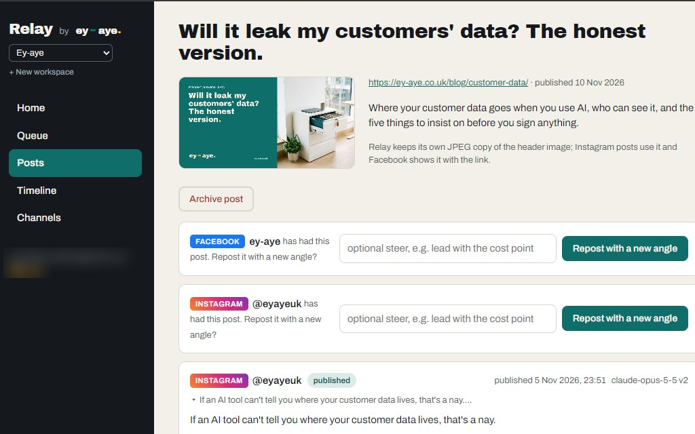

Every week a new post goes up on this blog. And every week, someone then had to copy it over to Facebook, write an Instagram caption, dig out the header image, and find a more businesslike angle for LinkedIn. Three platforms, three slightly different jobs, every single time.

We don't only post for Ey-aye, either. We look after the pages for a couple of other businesses too. That's the kind of small, repetitive chore that quietly eats an hour here and an hour there.

So we fixed it. Not with another monthly subscription, but by building our own tool. We called it Relay.

## Why we didn't just buy something

There are plenty of social media scheduling apps out there. Honestly, some of them would have done most of the job. But "most of the job" is the trouble with off-the-shelf software. You pay monthly for a hundred features you never touch, then find the one thing you actually need isn't there, or sits in the next price tier up.

What we wanted was narrow and specific:

- Spot a new blog post on our site as soon as it goes live, with no buttons to press
- Draft a version for each platform in our voice, not a generic one
- Let us approve or tweak each draft, from a browser or just by asking Claude in a chat
- Post at times that suit each audience, and tell us straight away if anything goes wrong
- Work for more than one business, with each one kept completely separate

Not long ago, that list would have meant months of developer time and a budget no small business has. Today, for people who build software for a living and use AI properly, it's a few days' work. So that's what we did.

## What Relay actually does

1. **It watches the blog.** Every hour it checks our site for anything new.
2. **Claude writes the drafts.** For each new post it writes a separate version for Facebook, Instagram and LinkedIn: a short hook for one, a caption with hashtags for another, a more professional angle for the third. The post's header image goes with them.
3. **A person approves.** Nothing goes out on its own. We read each draft, edit it or send it back with a note, then approve it. We can do that in a simple web dashboard, or by asking Claude "what's waiting for me?"
4. **It schedules sensibly.** Each page has its own posting slots, say Tuesday and Thursday at 9am. Approve a draft and it drops into the next free slot, unless we pick a time.
5. **It posts, and speaks up when something's wrong.** If a platform turns a post down, Relay tries again a few times, then emails us. Every morning at 7am we get a short note of what went out and what needs a look.

<figure>

<figcaption>Relay's view of one blog post: each platform gets its own version, its own status and a button to repost it with a fresh angle.</figcaption></figure>

Each platform moves along on its own, so the Facebook post can be live while we're still polishing the LinkedIn one.

## AI inside it, and AI behind it

Relay uses AI to write its drafts, but it was also built with AI. Claude was our very fast pair of hands; decades of software architecture experience were the judgement on top. That combination is the whole point. AI can write a lot of code quickly. Knowing which code to write, and what goes wrong once real customers and real accounts are involved, is still the job of an experienced engineer.

So the parts that matter got proper thought, even on a small tool:

- **Logins stay locked away.** Nobody ever pastes a Facebook key into a box. You sign in with Facebook the normal way, and the access Relay gets is encrypted and never shown on screen, to anyone.
- **Each business is sealed off from the others.** Every piece of data belongs to one business, and Relay works out which business you are from who's signed in, never from anything typed into a form.
- **It won't double-post.** If Facebook goes quiet halfway through a post, that post might already be live. Rather than retry blindly and post twice, Relay stops and asks a person.
- **It checks itself every morning.** At 6am it tests each connection, so an expired login turns up as a polite email, not a missing week of posts.
- **There's a paper trail.** Every attempt, retry and AI draft is recorded, including which version of our instructions produced it and what it cost to run.

None of that is exotic. It's simply what good software has always needed, and what quick DIY jobs and cheap apps tend to skip. It runs on Cloudflare, so there's no server sat in a cupboard for anyone to look after.

## The bigger point: software that fits you

For years, small businesses have had two choices. Bend the way you work to fit an off-the-shelf app, or pay a developer tens of thousands for something bespoke. Most sensibly chose the first and lived with the gaps: the spreadsheet next to the booking system, the copy-and-paste between the till and the accounts, the job someone does every Friday because two systems won't talk to each other.

That trade-off has shifted. With AI doing much of the heavy lifting, a small, well-built tool that fits exactly how your business works now takes days or weeks, not months. It can plug into the systems you already use, do the one job you need, and nothing else. Less to learn, less to pay for every month, and nobody else's product roadmap to wait on.

The catch is the same as it's always been. Fast and sloppy is still sloppy. Speed only helps if whoever's steering knows how to build something secure and reliable. That's the bit we bring.

## When not to build, and how we can help

We'll be straight with you: building isn't always the answer.

<b class="nay">nay</b>to building when an off-the-shelf tool does 95% of what you need at a fair price. Use it.

<b class="aye">aye</b>to building when there's a repetitive job no app quite covers, two systems that should talk and don't, or a way of working that's genuinely yours.

If something like that is nagging at you, that's exactly what our [free look-round](/look-round/) is for. We'll see how you work, tell you honestly whether it's worth building, and if it is, give you a [fixed price](/build/) up front. Relay took us a few days. Yours might too.

Or drop us a line at [howdo@ey-aye.co.uk](mailto:howdo@ey-aye.co.uk).
